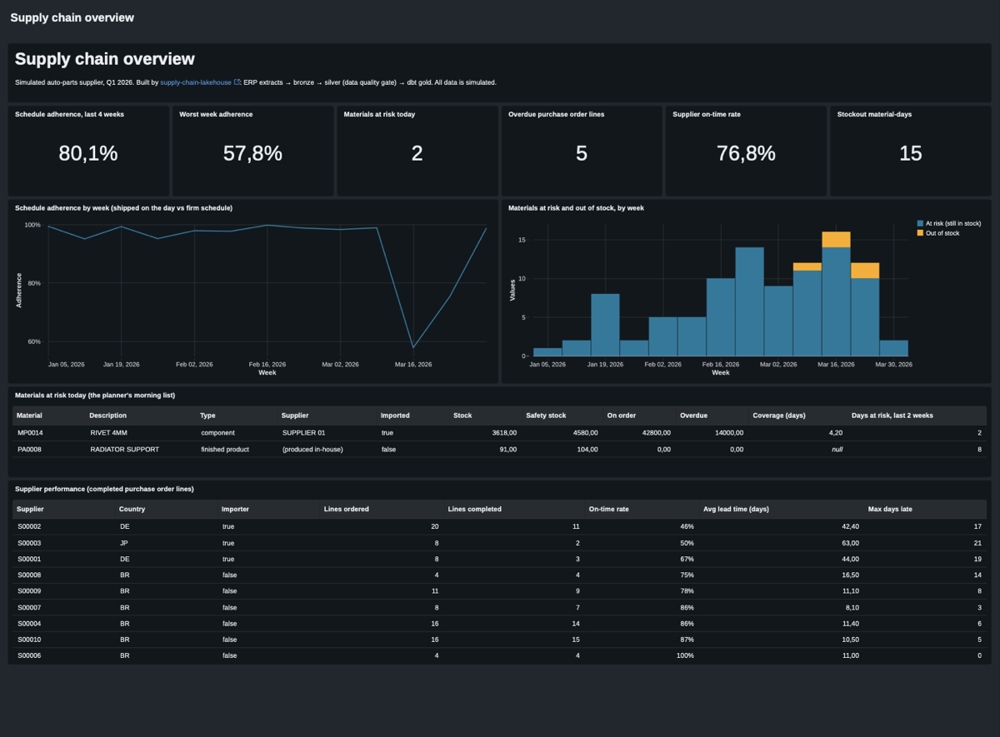

# Supply chain lakehouse

[](https://github.com/estefersonsampaio/supply-chain-lakehouse/actions/workflows/ci.yml)

> **ES:** Pipeline de datos de supply chain (MRP de un proveedor de autopartes) en Databricks: ingesta incremental, capas bronze/silver/gold, modelado con dbt, tests de calidad de datos y orquestación como código. Proyecto de portfolio con datos simulados. **En construcción.**

**Status: work in progress.** This README will grow with the project.

## What this is

A portfolio project that rebuilds the analytical side of an MRP (material requirements planning) process for an auto-parts supplier, using a modern lakehouse stack:

- a Python generator of realistic, messy ERP extracts;
- incremental ingestion into Delta tables (bronze);
- cleaning, typing and deduplication with PySpark (silver);
- a star schema and supply chain KPIs modelled with dbt, with data quality tests (gold);
- one Databricks Job that runs the whole flow, deployed from this repository.

The idea comes from real work: years ago I built an MRP for a supplier of the main automakers (customer schedules, purchasing, imports, stock and production orders) on an on-premise ERP. This project asks how I would build the data side of it today.

**All data is simulated.** No real company data is used, not even anonymized.

## Stack

Python 3.12 · PySpark · Databricks (Free Edition) · Delta Lake · dbt · Databricks Asset Bundles · GitHub Actions

## Design

- [docs/architecture.md](docs/architecture.md): business problem, data flow, gold model, KPIs and key decisions.
- [docs/data-dictionary.md](docs/data-dictionary.md): every raw ERP column, its clean name and the planted data problems.

## The data generator

A small Python package (no dependencies) simulates the plant day by day: customers send delivery schedules, production follows the firm demand and the bill of materials, shipments go out, and a simple MRP rule places purchase orders with domestic and importing suppliers, some of which deliver late. Then it plants data problems on purpose (duplicates, malformed codes, impossible dates, unit variants, bad quantities, decimal commas, orphan references) and writes one CSV per extract and business day, plus a manifest that counts every planted problem.

```bash
uv sync
uv run python -m supply_chain_generator --days 60 --out data/landing
```

```
44 business days written to data/landing
  customer_schedules      18539 rows
  inventory_movements      2275 rows
  shipments                 905 rows
  ...
planted problems: bad_quantity=89, code_format=84, decimal_comma=74, duplicate=99, ...
```

The same seed always produces the same files, and adding days never changes the files of earlier days, which is what incremental ingestion needs. In a clean 90-day run (seed 42), customer service stays around 99% until an imported component arrives late in mid-March and service drops to 60-75% for two weeks: exactly the kind of event the KPIs have to show.

The generator tests check reproducibility, file layout, referential integrity of the clean data, that stock never goes negative, and that the manifest matches what was actually planted.

## Bronze: incremental ingestion on Databricks

Everything in the workspace is defined as code in a Databricks Asset Bundle ([databricks.yml](databricks.yml) and [resources/](resources/)): one schema per layer (`sc_landing`, `sc_bronze`, `sc_silver`, `sc_gold`), the landing and checkpoint volumes, and the `supply_chain_pipeline` job.

[pipelines/bronze_ingest.py](pipelines/bronze_ingest.py) runs one Auto Loader stream per extract with `trigger(availableNow=True)`: each run loads only the files that arrived since the last run, then stops. Bronze keeps the data exactly as delivered (all text, padded codes, wrong dates included) and adds lineage columns: `_source_file`, `_file_date` and `_ingested_at`.

Databricks Free Edition cannot register external cloud storage, so the landing zone is a Unity Catalog volume. [scripts/upload_landing.py](scripts/upload_landing.py) uploads the generated files up to a given date and skips files already there, which simulates files arriving day by day.

Proof of incremental, idempotent loading (first run on 4 weeks of files, then 4 more weeks, then a run with nothing new):

| Extract | Run 1 | Run 2 | Run 3 | Total | Expected (manifests) |
|---|---:|---:|---:|---:|---:|
| customer_schedules | +8,429 | +8,421 | +0 | 16,850 | 16,850 |
| inventory_movements | +1,036 | +1,031 | +0 | 2,067 | 2,067 |
| shipments | +399 | +422 | +0 | 821 | 821 |
| purchase_orders | +24 | +48 | +0 | 72 | 72 |
| goods_receipts | +15 | +21 | +0 | 36 | 36 |

All nine extracts matched the generator manifests exactly.

```bash
databricks bundle deploy -p <profile>
uv run python scripts/upload_landing.py --until 2026-01-30 --profile <profile>
databricks bundle run supply_chain_pipeline -p <profile>
```

## Silver: cleaning, quarantine and a data quality gate

[pipelines/silver_transform.py](pipelines/silver_transform.py) turns each bronze table into a clean, typed table with English column names ([pipelines/silver_spec.py](pipelines/silver_spec.py) holds the mapping). The rules live in [pipelines/silver_rules.py](pipelines/silver_rules.py) as pure functions, tested on local Spark:

| Problem | Action |
|---|---|
| Exact duplicate in the same file | removed |
| Material code in the wrong format | fixed (trim + uppercase) |
| Unit variant (`pcs`, `kg`, `LT`, grams) | fixed (`PC` / `KG` / `L`, grams converted to KG) |
| Decimal comma | fixed |
| Impossible date | quarantined |
| Negative quantity, or zero where zero makes no sense | quarantined |
| Material code that is not in the material master | quarantined |

Quarantined rows are not dropped: they go to `sc_silver.quarantine` with the reason and the raw record, as they would need to be fixed at the source. Master data keeps the latest valid version of each record.

**Data quality gate.** Silver counts every problem it detects and compares the counts with the generator manifests in `sc_silver.dq_reconciliation`. If any count differs, the job fails. Result of the run on 8 weeks of files (24,000+ rows, 63 checks):

| Problem | Planted | Detected | Action |
|---|---:|---:|---|
| duplicate | 88 | 88 | removed |
| bad_quantity | 82 | 82 | quarantined |
| invalid_date | 81 | 81 | quarantined |
| code_format | 78 | 78 | fixed |
| decimal_comma | 70 | 70 | fixed |
| orphan_reference | 68 | 68 | quarantined |
| unit_variant | 4 | 4 | fixed |

Silver is a full refresh (overwrite) on every run: at this volume it takes seconds and makes re-runs always safe. An incremental `MERGE` is a possible next step.

## Gold: star schema and supply chain KPIs with dbt

The [dbt project](dbt/) builds the gold layer on the Databricks SQL warehouse and runs as the third task of the job (`dbt build`: 12 models, 42 data tests).

- **Dimensions:** `dim_material`, `dim_supplier`, `dim_customer`, `dim_date`.
- **Facts:** `fct_customer_schedule` (the last word of the customer for each due date), `fct_shipments`, `fct_purchase_lines` (ordered vs received, lead time, lateness), `fct_inventory_daily` (closing stock rebuilt from every movement).
- **KPIs:**

| Model | Question it answers |
|---|---|
| `kpi_stock_coverage` | How many days does the stock cover, and is the material at risk? Components follow MRP logic (stock + open orders − demand during the lead time vs safety stock), and open orders past their promised date are shown as overdue. |
| `kpi_stockout_risk` | The planner's morning list: materials at risk today, with stock, open and overdue orders and supplier. |
| `kpi_supplier_performance` | On-time rate, lead time and lateness per supplier. |
| `kpi_schedule_adherence` | Did we ship what the customer scheduled, on the day they scheduled it? |

Tests cover keys, relationships between facts and dimensions, accepted values, value ranges and business rules (no receipt before its order, no receipt above the ordered quantity). A warning-level test reports negative stock: it can appear when silver quarantines movements, which is a real consequence of source data problems.

**What the KPIs show in the simulated quarter.** A domestic supplier promised 2,500 lock plates for 10 March and delivered them partially on 16 March and the rest on 24 March. The component ran out on 13 March, two finished products that use it ran out from 16 to 26 March, and weekly schedule adherence dropped from 98-99% to 58% and 75%. The risk KPI flagged the component on 9 March, four business days before it ran out, when its stock fell below safety stock, and showed the 2,500 pieces as overdue from 11 March.

| Week | Schedule adherence |
|---|---:|
| 2 Mar | 98.3% |
| 9 Mar | 98.9% |
| 16 Mar | **57.8%** |
| 23 Mar | **75.3%** |
| 30 Mar | 98.7% |

To run dbt from your machine, see [dbt/profiles.example.yml](dbt/profiles.example.yml) (it uses a short-lived token from the Databricks CLI, so no personal access token is needed).

## Dashboard

A Databricks AI/BI dashboard on the gold layer, also deployed from the bundle ([dashboards/supply_chain.lvdash.json](dashboards/supply_chain.lvdash.json)): headline numbers, weekly schedule adherence, materials at risk by week, the planner's list for today and supplier performance. The March stockout is visible in both charts.



## Tests

```bash
uv run pytest
```

31 Python tests (plus the 42 dbt data tests above): the generator (reproducibility, integrity of clean data, manifest accuracy) and the silver rules on local Spark, including an end-to-end check that every problem planted in a generated dataset is detected. Local Spark needs Java 17 or 21 (`brew install openjdk@17` on macOS; `tests/conftest.py` picks it up).

## How to run it yourself

Everything runs on a free [Databricks Free Edition](https://www.databricks.com/learn/free-edition) workspace.

**Prerequisites:** [uv](https://docs.astral.sh/uv/), the [Databricks CLI](https://docs.databricks.com/dev-tools/cli/install.html), and Java 17 or 21 if you want to run the Spark tests locally.

```bash
# 1. Install and check everything locally
git clone https://github.com/estefersonsampaio/supply-chain-lakehouse.git
cd supply-chain-lakehouse
uv sync
uv run pytest

# 2. Log in to your workspace (OAuth in the browser, no token to copy)
databricks auth login --host https://<your-workspace-host> --profile free

# 3. Create schemas, volumes, the job and the dashboard
databricks bundle deploy -p free

# 4. Generate a quarter of ERP extracts and deliver the first four weeks
uv run python -m supply_chain_generator --days 90 --out data/landing
uv run python scripts/upload_landing.py --until 2026-01-30 --profile free

# 5. Run the pipeline: bronze -> silver (data quality gate) -> dbt gold
databricks bundle run supply_chain_pipeline -p free

# 6. Deliver the rest of the quarter and run again: only the new files are loaded
uv run python scripts/upload_landing.py --until 2026-03-31 --profile free
databricks bundle run supply_chain_pipeline -p free

# 7. Open the dashboard (the URL is in the summary)
databricks bundle summary -p free
```

The job has a schedule for every business day at 07:00 (Madrid), paused by default. To turn it on: `databricks bundle deploy --var="schedule_status=UNPAUSED" -p free`. To remove everything from the workspace: `databricks bundle destroy -p free`.

The dbt task uses the SQL warehouse called `Serverless Starter Warehouse`, which Free Edition creates for you. A full run takes about 5 minutes, most of it starting serverless compute.

## Roadmap

- [x] Data generator with planted data problems
- [x] Bronze: incremental ingestion
- [x] Silver: cleaning, deduplication, quarantine, data quality gate
- [x] Gold: dbt star schema, KPIs and tests
- [x] Databricks Job deployed as code (bronze -> silver -> gold)
- [x] CI with GitHub Actions (lint, tests on local Spark, dbt parse)
- [x] Dashboard (Databricks AI/BI, deployed as code)
- [x] How to run it yourself

**Next steps** (beyond the first version): incremental `MERGE` in silver instead of a full refresh; landing files in external cloud storage on a paid workspace; detecting anomalies in supplier lead times on top of gold.

## Author

Esteferson Sampaio · [LinkedIn](https://www.linkedin.com/in/estefersonsampaio/)
